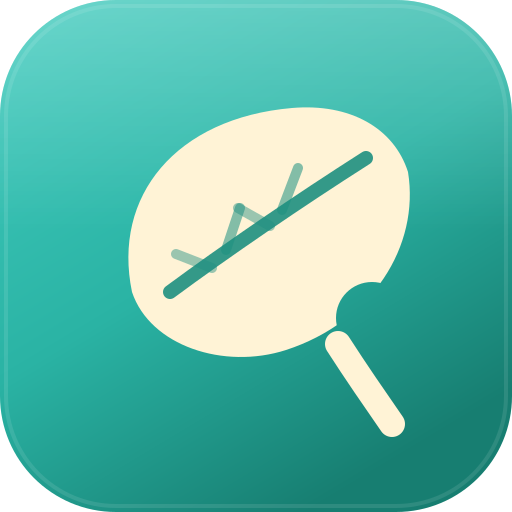
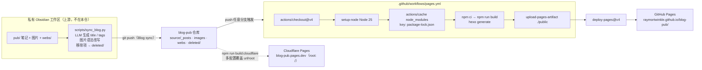
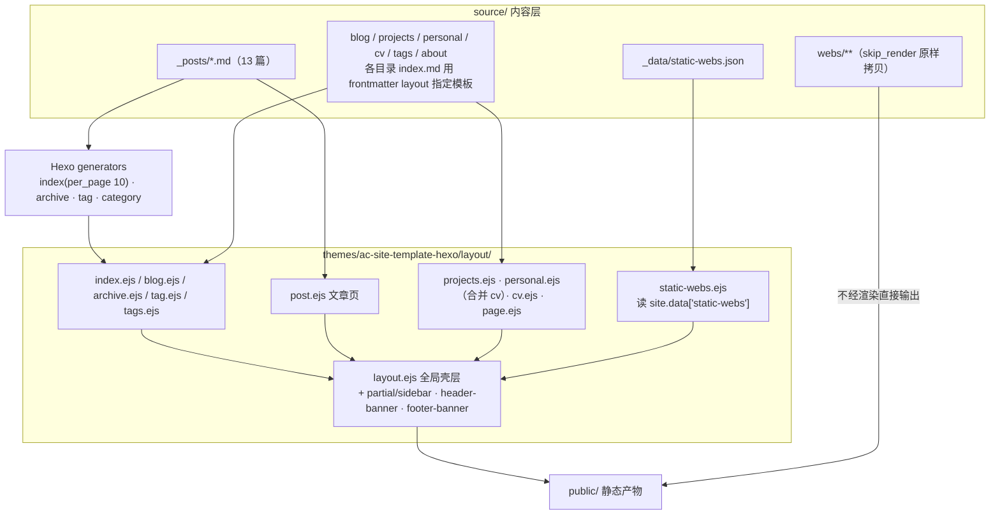
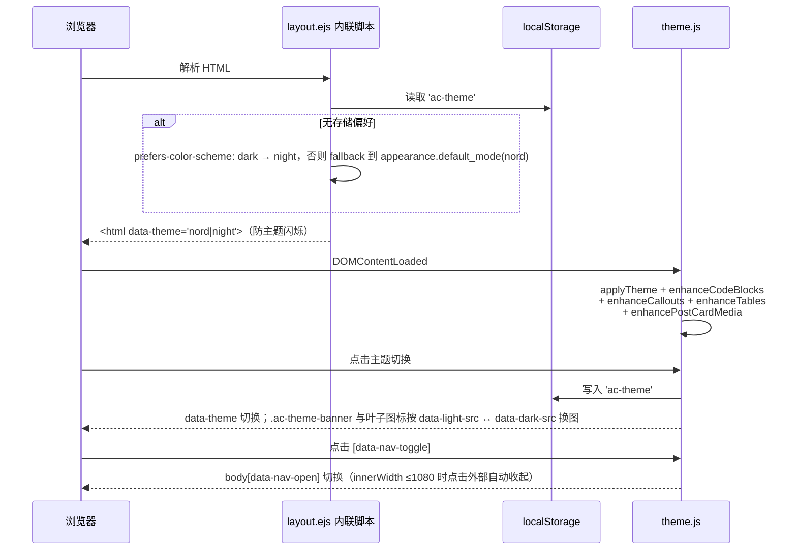
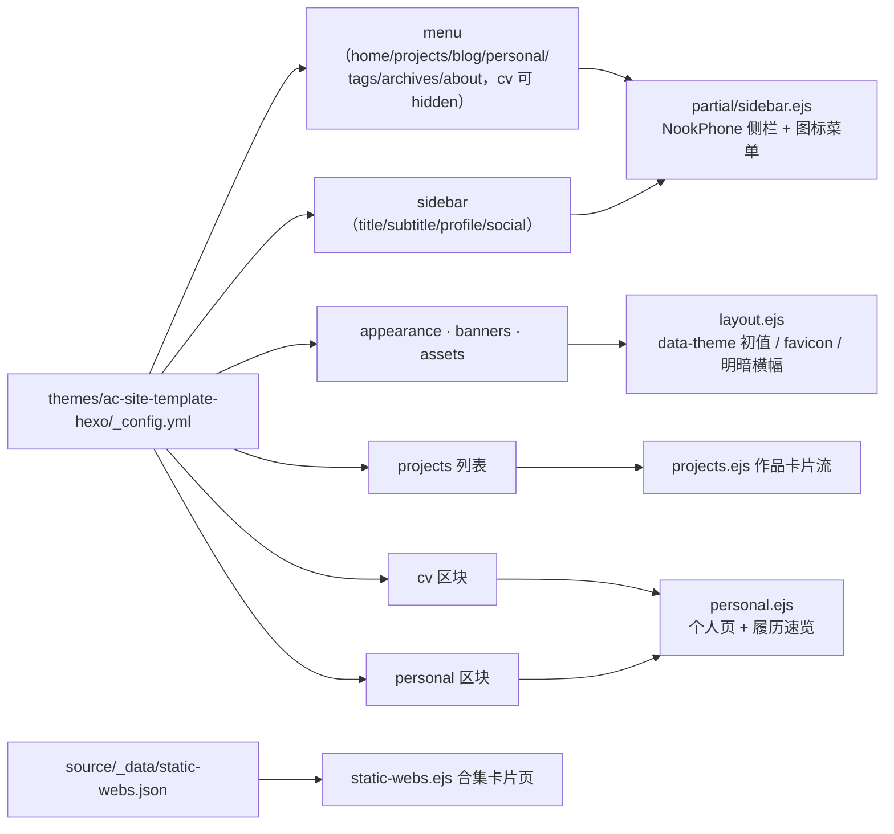

<div align="center">

> [English](./README_en.md) | **简体中文**



# blog-pub — Ray's Garden 的 Hexo 站点源码

**在 Obsidian 里写笔记，push 之后就是一篇上线的动森风博客。**


-339933?logo=nodedotjs&logoColor=white)


</div>

---

## 它解决什么问题

这是个人博客 **Ray's Garden**（[raymortwinkle.github.io/blog-pub](https://raymortwinkle.github.io/blog-pub/)）的站点源码仓，也是上游私有 Obsidian 工作区的**公开发布产物**：

- 上游工作区扫描 `pub/` 笔记，用 LLM 生成 frontmatter、改写图片语法、归档删除内容，然后 `git push` 到本仓——**写作流程完全留在 Obsidian 里**；
- 本仓接住产物，push 任意分支即触发 GitHub Actions 构建并部署到 GitHub Pages；
- 同一套源码另有一份 Cloudflare Pages 覆盖配置，一条命令产出**根路径版**镜像。

主题不是现成模板，而是仓内自研的 **`ac-site-template-hexo`**——把一套 Astro 版"动物森友会 / NookPhone"风格个人站手工移植成 Hexo EJS 主题（移植映射表见 `themes/ac-site-template-hexo/docs/component-mapping.md`），Projects / CV / Personal 等页面内容全部由主题 `_config.yml` 数据驱动。

> 本仓是**产物仓**：`source/_posts/` 由上游同步脚本写入，手改会在下次 `Blog sync` 时被覆盖。

---

## ✨ 功能

- 🍃 **自研动森风主题**：NookPhone 式侧栏、`nord`/`night` 双主题切换（横幅与叶子图标跟随换图）、移动端抽屉导航，全部原生 JS + 单文件 CSS（`ac-` 前缀，~2000 行），无前端框架。
- 📇 **配置驱动的个人站**：`themes/ac-site-template-hexo/_config.yml` 一处维护菜单、侧栏资料、Projects 作品集、CV 履历、Personal 主页——CV 区块自动合并渲染进 Personal 页。
- 💬 **Obsidian 语法兼容**：`> [!tip]`、`> [!warning]` 等 callout 在浏览器端转成带中文标题的样式卡片；表格自动包滚动容器、代码块注入复制按钮、卡片封面图加载失败自动隐藏。
- 🗂️ **静态网页合集**：`source/webs/` 下的 HTML 小项目走 `skip_render` 原样发布，由 `source/_data/static-webs.json` 生成索引卡片页（`/projects/static-webs/`）。
- 🚀 **双目标部署**：GitHub Pages（`root: /blog-pub/`）+ Cloudflare Pages（`root: /`，`_config.cloudflare.yml` 多配置覆盖）；push 任意分支即构建。
- 🗑️ **删除即归档**：上游移除的笔记/图片/网页不会真丢，进入 `deleted/` 存档。
- 📦 **可复现构建**：`package-lock.json` 锁定依赖，CI 用 `npm ci`；Dependabot 每日盯 npm 依赖。

---

## 🚀 快速开始

### 方式一：面向 AI Agent（一键提示词）

````markdown
请帮我在本地跑起这个 Hexo 博客并写一篇文章：
1. git clone https://github.com/RayMorTwinkle/blog-pub.git && cd blog-pub
2. npm ci（依赖由 package-lock.json 锁定，需要 Node.js，CI 用的是 25）
3. npm run server 启动预览；站点 root 是 /blog-pub/，
   打开 http://localhost:4000/blog-pub/ 而不是根路径
4. 用 npx hexo new post "标题" 或直接往 source/_posts/ 放带 frontmatter 的 md
5. npm run build 产出 public/；npm run build:cloudflare 产出根路径版本
约束：不要改 themes/ac-site-template-hexo/ 除非我明确要求；
不要动 deleted/ 目录；页面内容（Projects/CV/Personal）
在 themes/ac-site-template-hexo/_config.yml 里维护。
````

### 方式二：面向人类用户

```bash
git clone https://github.com/RayMorTwinkle/blog-pub.git
cd blog-pub
npm ci
npm run server        # → http://localhost:4000/blog-pub/
```

> **环境要求**：Node.js（CI 使用 Node 25）+ npm。主题已在 `themes/` 仓内，无需额外安装。

---

## 🖥️ 使用

| 命令 | 作用 |
|---|---|
| `npm run server` | `hexo server` 本地预览（注意 URL 带 `/blog-pub/`） |
| `npm run build` | `hexo generate` 产出 `public/`（GitHub Pages 用） |
| `npm run build:cloudflare` | `hexo clean && hexo generate --config _config.yml,_config.cloudflare.yml`（根路径版） |
| `npm run clean` | `hexo clean` 清缓存与产物 |
| `npx hexo new post "标题"` | 按 `scaffolds/post.md` 新建文章 |

**内容编辑入口**（改内容该去哪）：

| 内容 | 位置 |
|---|---|
| 博客文章 | `source/_posts/`（正常由上游同步写入） |
| 文章配图 | `source/images/`（文中引用 `/images/xxx.png`） |
| Projects / CV / Personal / 菜单 / 侧栏 | `themes/ac-site-template-hexo/_config.yml` |
| About 页 | `source/about/index.md` |
| 静态网页合集 | `source/webs/` 放 HTML；索引元数据在 `source/_data/static-webs.json` |
| 页面模板 | `themes/ac-site-template-hexo/layout/*.ejs` |

---

## 🏗️ 架构

### 发布流水线



### 页面 → 布局路由



### 主题运行时（浏览器端）



### 配置驱动的内容流



---

## 📂 目录结构

```text
blog-pub/
├── _config.yml                  # Hexo 主配置：站点信息、root=/blog-pub/、permalink、主题
├── _config.cloudflare.yml       # Cloudflare 覆盖配置（url + root:/），多配置合并用
├── _config.landscape.yml        # landscape 主题残留空文件（现役主题是 ac-site-template-hexo）
├── package.json                 # hexo 8.1.2 + 8 个官方插件；build/clean/deploy/server 脚本
├── package-lock.json            # CI 用 npm ci 锁定构建
├── scaffolds/                   # hexo new 的 post/draft/page 模板
├── source/
│   ├── _posts/                  # 博客文章（上游同步写入，13 篇）
│   ├── images/                  # 文章配图
│   ├── webs/                    # 静态网页合集（skip_render 原样发布）
│   ├── _data/static-webs.json   # 合集索引（slug/title/tags/order/updated/path）
│   └── blog·projects·personal·cv·tags·about/   # 页面 index.md（layout 指定模板）
├── themes/ac-site-template-hexo/
│   ├── _config.yml              # menu / sidebar / projects / cv / personal 内容数据
│   ├── layout/                  # 12 个 EJS 布局 + 5 个 partial（sidebar/post-card/paginator/…）
│   ├── source/css/ac-theme.css  # ~2091 行主题样式，类名 ac- 前缀，data-theme=night 覆盖
│   ├── source/js/theme.js       # ~290 行：主题切换/代码复制/callout/表格/抽屉导航
│   ├── source/ac-assets/        # 明暗横幅、菜单图标、头像、favicon
│   └── docs/                    # content-editing.md / component-mapping.md
├── deleted/                     # 上游删除内容的归档（含时间戳防冲突）
└── .github/
    ├── workflows/pages.yml      # push → npm ci → hexo generate → deploy GitHub Pages
    └── dependabot.yml           # npm daily，open-pull-requests-limit: 20
```

---

## 🔧 技术细节

- **双站点同构**：GitHub Pages 走 `_config.yml`（`url: raymortwinkle.github.io`，`root: /blog-pub/`）；Cloudflare 用 `hexo generate --config _config.yml,_config.cloudflare.yml` 把 `url`/`root` 覆盖为 `blog-pub.pages.dev` + `/`。
- **永久链接**：`:year/:month/:day/:title/`，`pretty_urls.trailing_index/trailing_html` 均开。
- **渲染管线**：`hexo-renderer-marked` + `hexo-renderer-ejs` + `hexo-renderer-stylus`；`syntax_highlighter: highlight.js`（`line_number: true`），`prismjs.preprocess: true` 也在配置中；`skip_render: webs/**`。
- **首页/分页**：`index_generator: path:"", per_page:10, order_by:-date`；`external_link.enable: true, field: site`；`updated_option: mtime`；`future: true`、`render_drafts: false`。
- **主题切换**：localStorage 键 `ac-theme`，值 `nord`/`night`；`<head>` 内联脚本先行写 `<html data-theme>` 防闪烁，无偏好时回落到 `prefers-color-scheme`；`appearance.enable_theme_toggle` 控制开关。
- **Callout 识别**：`theme.js` 用正则 `^\[!([a-z-]+)\][+-]?\s*(.*)$` 匹配 blockquote 首行，按别名归一到 note/info/abstract/tip/warning/danger/success/question/todo/example/quote，中文标题映射（笔记/信息/摘要/提示/注意/危险/完成/问题/待办/示例/引用）。
- **代码复制**：给 `.ac-prose` 内 `figure.highlight` 注入 `.ac-code-copy`，优先 `navigator.clipboard`，降级 `execCommand('copy')`。
- **KaTeX**：仅 `post`/`page` 布局加载 `cdn.jsdelivr.net/npm/katex@0.16.11` 的 CSS。
- **CI**：`pages.yml` 触发条件 `push: branches: '**'`；`actions/cache` 以 `hashFiles('package-lock.json')` 为 key 缓存 `node_modules`；产物 `./public` 经 `upload-pages-artifact@v3` → `deploy-pages@v4`。
- **主题移植来源**：`docs/component-mapping.md` 记录了 Astro 参考站到 Hexo 的组件级映射（BaseLayout→layout.ejs、SideBar→partial/sidebar.ejs 等）与交互降级方案（View Transitions 未迁移、Drawer/主题切换改原生 JS）。

---

## ❓ 常见问题

**Q：`hexo server` 打开是 404 / 样式没加载？**
A：`_config.yml` 里 `root: /blog-pub/`，本地预览要访问 `http://localhost:4000/blog-pub/`。

**Q：能直接在 GitHub 网页上改文章吗？**
A：不建议。`source/_posts/`、`source/images/`、`source/webs/` 由上游 Obsidian 工作区同步脚本写入，`Blog sync` 提交会覆盖手改；要改页面型内容请改主题 `_config.yml` 或 `source/about/index.md`。

**Q：为什么 `webs/` 里的 HTML 不被 Markdown 渲染？**
A：故意的——`skip_render: webs/**`，这些文件原样拷贝进 `public/`，作为可直接访问的小网页。

**Q：GitHub Pages 和 Cloudflare Pages 怎么共存？**
A：一套源码 + 两份配置。默认配置服务子路径 `/blog-pub/`；`build:cloudflare` 用 Hexo 多配置合并覆盖 `url`/`root` 产出根路径站点。

**Q：CV 菜单项去哪了？**
A：主题 `_config.yml` 中 `menu.cv.hidden: true`，CV 数据合并渲染在 Personal 页的"履历速览"里；删掉 `hidden` 行即可恢复独立 CV 页。

---

## ⚠️ 注意事项

- 本仓是发布产物仓：批量改文章请回到上游 Obsidian 工作区走同步链路；`deleted/` 是归档，不是回收站快捷恢复口。
- `public/`、`node_modules/`、`db.json`、`.deploy*/`、`_multiconfig.yml` 在 `.gitignore` 中，均为本地构建产物。
- `deploy` 脚本（`hexo deploy`）存在但 `deploy.type` 为空——实际部署走 GitHub Actions / Cloudflare，不走 `hexo deploy`。
- `hexo-theme-landscape` 仍是 `package.json` 依赖但非现役主题，`_config.landscape.yml` 为空文件。

---

## 📄 License

未声明 License。文章与站点内容为作者所有，转载请先联系。

---

## 🙏 致谢

- [Hexo](https://hexo.io/) 及官方插件生态（`hexo-generator-*`、`hexo-renderer-*`、`hexo-server`）
- 上游私有工作区 Obsidian-Hexo-Auto（私有仓）：同步脚本与发布链路的起点
- 主题移植参考：Astro 版个人站模板（映射表见 `themes/ac-site-template-hexo/docs/component-mapping.md`）
- GitHub Pages / Cloudflare Pages / jsDelivr（KaTeX CDN）

<div align="center">
<sub>blog-pub · 写笔记的地方在 Obsidian，开花的地方在这里。</sub>
</div>
