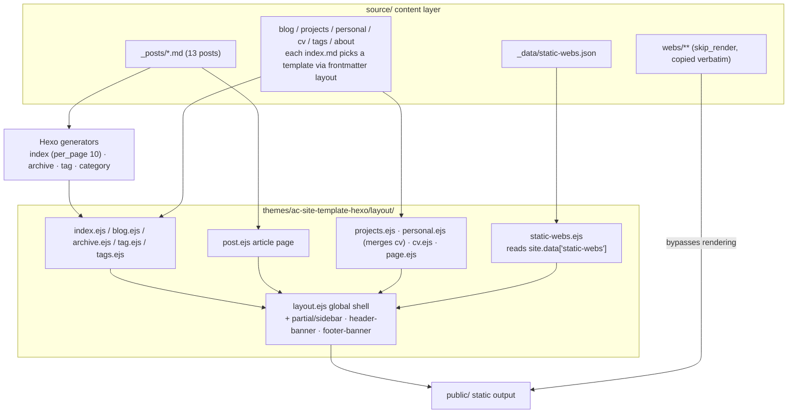
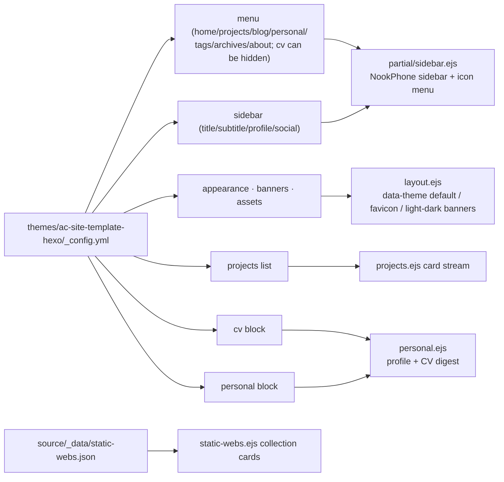

<div align="center">

> English | [简体中文](./README.md)


# blog-pub — Hexo site source for Ray's Garden

**Write notes in Obsidian; after one push, they go live as an Animal-Crossing-style blog.**


-339933?logo=nodedotjs&logoColor=white)


</div>

---

## Why it exists

This is the site source of the personal blog **Ray's Garden** ([raymortwinkle.github.io/blog-pub](https://raymortwinkle.github.io/blog-pub/)) — and the **public publishing target** of an upstream private Obsidian workspace:

- The upstream workspace scans notes under `pub/`, generates frontmatter with an LLM, rewrites image syntax, archives removed content, then `git push`es to this repo — **the entire writing flow stays inside Obsidian**;
- This repo receives the artifacts; pushing to any branch triggers GitHub Actions to build and deploy to GitHub Pages;
- The same source ships a Cloudflare Pages override config, producing a **root-path mirror** with one command.

The theme is not an off-the-shelf template — it's the in-repo **`ac-site-template-hexo`**, a hand-port of an Astro "Animal Crossing / NookPhone" personal-site design to Hexo EJS (see the mapping table in `themes/ac-site-template-hexo/docs/component-mapping.md`). Projects / CV / Personal page content is entirely data-driven by the theme `_config.yml`.

> This is an **artifact repo**: `source/_posts/` is written by the upstream sync script — manual edits get overwritten by the next `Blog sync`.

---

## ✨ Features

- 🍃 **Custom AC-style theme**: NookPhone-like sidebar, `nord`/`night` theme toggle (banners and the leaf icon swap images accordingly), mobile drawer nav — all vanilla JS + a single `ac-`-prefixed CSS file (~2000 lines), no frontend framework.
- 📇 **Config-driven personal site**: one file, `themes/ac-site-template-hexo/_config.yml`, holds the menu, sidebar profile, Projects showcase, CV and Personal page — the CV block is merged into the Personal page automatically.
- 💬 **Obsidian syntax compatibility**: `> [!tip]`, `> [!warning]` and friends become styled callout cards with localized titles in the browser; tables get wrapped in scroll containers, code blocks get copy buttons, broken card cover images hide themselves.
- 🗂️ **Static web collection**: HTML mini-projects under `source/webs/` pass through untouched via `skip_render`, indexed into a card page (`/projects/static-webs/`) by `source/_data/static-webs.json`.
- 🚀 **Dual-target deployment**: GitHub Pages (`root: /blog-pub/`) + Cloudflare Pages (`root: /`, via `_config.cloudflare.yml` multi-config override); any branch push builds.
- 🗑️ **Deletes become archives**: notes / images / web projects removed upstream land in `deleted/` instead of disappearing.
- 📦 **Reproducible builds**: `package-lock.json` pins dependencies, CI runs `npm ci`; Dependabot watches npm daily.

---

## 🚀 Quick Start

### Option 1: for AI Agents (one-shot prompt)

````markdown
Please run this Hexo blog locally and write a post:
1. git clone https://github.com/RayMorTwinkle/blog-pub.git && cd blog-pub
2. npm ci (dependencies pinned by package-lock.json; CI uses Node 25)
3. npm run server; the site root is /blog-pub/, so open
   http://localhost:4000/blog-pub/ — not the bare root
4. npx hexo new post "Title", or drop a frontmatter'd md into source/_posts/
5. npm run build outputs public/; npm run build:cloudflare builds the root-path variant
Constraints: do NOT touch themes/ac-site-template-hexo/ unless I ask;
do NOT touch deleted/; page content (Projects/CV/Personal) lives in
themes/ac-site-template-hexo/_config.yml.
````

### Option 2: for humans

```bash
git clone https://github.com/RayMorTwinkle/blog-pub.git
cd blog-pub
npm ci
npm run server        # → http://localhost:4000/blog-pub/
```

> **Requirements**: Node.js (CI uses Node 25) + npm. The theme ships inside `themes/` — nothing extra to install.

---

## 🖥️ Usage

| Command | Effect |
|---|---|
| `npm run server` | `hexo server` local preview (mind the `/blog-pub/` URL prefix) |
| `npm run build` | `hexo generate` → `public/` (for GitHub Pages) |
| `npm run build:cloudflare` | `hexo clean && hexo generate --config _config.yml,_config.cloudflare.yml` (root-path build) |
| `npm run clean` | `hexo clean` — clears cache and output |
| `npx hexo new post "Title"` | New post from `scaffolds/post.md` |

**Where to edit content**:

| Content | Location |
|---|---|
| Blog posts | `source/_posts/` (normally written by upstream sync) |
| Post images | `source/images/` (referenced as `/images/xxx.png`) |
| Projects / CV / Personal / menu / sidebar | `themes/ac-site-template-hexo/_config.yml` |
| About page | `source/about/index.md` |
| Static web collection | HTML into `source/webs/`; index metadata in `source/_data/static-webs.json` |
| Page templates | `themes/ac-site-template-hexo/layout/*.ejs` |

---

## 🏗️ Architecture

### Publishing pipeline

```mermaid
flowchart LR
  subgraph OBS["Private Obsidian workspace (upstream, not in this repo)"]
    PUB["pub/ notes + images + webs/"]
    SYNC["scripts/sync_blog.py<br/>LLM-generated title / tags<br/>image syntax rewrite<br/>removed items → deleted/"]
    PUB --> SYNC
  end
  SYNC -->|"git push (Blog sync)"| REPO["blog-pub repo<br/>source/_posts · images · webs · deleted/"]
  REPO -->|"push to any branch"| CI
  subgraph CI[".github/workflows/pages.yml"]
    direction TB
    C1["actions/checkout@v4"] --> C2["setup-node Node 25"] --> C3["actions/cache node_modules<br/>key: package-lock.json"] --> C4["npm ci → npm run build<br/>hexo generate"] --> C5["upload-pages-artifact ./public"]
  end
  C5 --> DEPLOY["deploy-pages@v4"] --> GP["GitHub Pages<br/>raymortwinkle.github.io/blog-pub/"]
  REPO -.->|"npm run build:cloudflare<br/>multi-config url/root override"| CF["Cloudflare Pages<br/>blog-pub.pages.dev (root: /)"]
```



### Page → layout routing



### Theme runtime (browser side)

```mermaid
sequenceDiagram
  participant B as Browser
  participant H as Inline script in layout.ejs
  participant LS as localStorage
  participant T as theme.js

  B->>H: Parse HTML
  H->>LS: Read 'ac-theme'
  alt No stored preference
    H->>H: prefers-color-scheme: dark → night, else appearance.default_mode (nord)
  end
  H-->>B: <html data-theme="nord|night"> (anti-FOUC)
  B->>T: DOMContentLoaded
  T->>T: applyTheme + enhanceCodeBlocks<br/>+ enhanceCallouts + enhanceTables<br/>+ enhancePostCardMedia
  B->>T: Theme toggle clicked
  T->>LS: Write 'ac-theme'
  T-->>B: data-theme flips; .ac-theme-banner & leaf icon swap via data-light-src ↔ data-dark-src
  B->>T: [data-nav-toggle] clicked
  T-->>B: body[data-nav-open] toggles (auto-closes on outside click when innerWidth ≤1080)
```

### Config-driven content flow



---

## 📂 Project layout

```text
blog-pub/
├── _config.yml                  # Hexo main config: site info, root=/blog-pub/, permalink, theme
├── _config.cloudflare.yml       # Cloudflare override (url + root:/), merged via multi-config
├── _config.landscape.yml        # Empty leftover from the landscape theme (active theme is ac-site-template-hexo)
├── package.json                 # hexo 8.1.2 + 8 official plugins; build/clean/deploy/server scripts
├── package-lock.json            # Pins the CI build (npm ci)
├── scaffolds/                   # hexo new templates: post / draft / page
├── source/
│   ├── _posts/                  # Blog posts (written by upstream sync, 13 posts)
│   ├── images/                  # Post images
│   ├── webs/                    # Static web mini-projects (skip_render, served as-is)
│   ├── _data/static-webs.json   # Collection index (slug/title/tags/order/updated/path)
│   └── blog·projects·personal·cv·tags·about/   # Page index.md files (layout picks template)
├── themes/ac-site-template-hexo/
│   ├── _config.yml              # Content data: menu / sidebar / projects / cv / personal
│   ├── layout/                  # 12 EJS layouts + 5 partials (sidebar/post-card/paginator/…)
│   ├── source/css/ac-theme.css  # ~2091-line theme stylesheet, ac- prefix, data-theme=night overrides
│   ├── source/js/theme.js       # ~290 lines: theme toggle / code copy / callouts / tables / drawer
│   ├── source/ac-assets/        # Light/dark banners, menu icons, avatar, favicon
│   └── docs/                    # content-editing.md / component-mapping.md
├── deleted/                     # Archive of upstream-removed content (timestamped on conflicts)
└── .github/
    ├── workflows/pages.yml      # push → npm ci → hexo generate → deploy GitHub Pages
    └── dependabot.yml           # npm daily, open-pull-requests-limit: 20
```

---

## 🔧 Technical notes

- **One source, two sites**: GitHub Pages uses `_config.yml` (`url: raymortwinkle.github.io`, `root: /blog-pub/`); the Cloudflare build runs `hexo generate --config _config.yml,_config.cloudflare.yml`, overriding `url`/`root` to `blog-pub.pages.dev` + `/`.
- **Permalinks**: `:year/:month/:day/:title/` with `pretty_urls.trailing_index` and `trailing_html` enabled.
- **Render pipeline**: `hexo-renderer-marked` + `hexo-renderer-ejs` + `hexo-renderer-stylus`; `syntax_highlighter: highlight.js` (`line_number: true`); `prismjs.preprocess: true` is also configured; `skip_render: webs/**`.
- **Home/pagination**: `index_generator: path:"", per_page:10, order_by:-date`; `external_link.enable: true, field: site`; `updated_option: mtime`; `future: true`, `render_drafts: false`.
- **Theme toggle**: localStorage key `ac-theme`, values `nord`/`night`; an inline `<head>` script sets `<html data-theme>` first to avoid flashing, falling back to `prefers-color-scheme`; `appearance.enable_theme_toggle` gates the button.
- **Callout detection**: `theme.js` matches the first blockquote line against `^\[!([a-z-]+)\][+-]?\s*(.*)$` and normalizes aliases into note/info/abstract/tip/warning/danger/success/question/todo/example/quote, each with a localized title.
- **Code copy**: injects `.ac-code-copy` into `figure.highlight` inside `.ac-prose`, preferring `navigator.clipboard` with an `execCommand('copy')` fallback.
- **KaTeX**: only `post`/`page` layouts pull `katex@0.16.11` CSS from jsDelivr.
- **CI**: `pages.yml` triggers on `push: branches: '**'`; `actions/cache` caches `node_modules` keyed by `hashFiles('package-lock.json')`; `./public` goes through `upload-pages-artifact@v3` → `deploy-pages@v4`.
- **Theme provenance**: `docs/component-mapping.md` documents the Astro→Hexo component mapping (BaseLayout→layout.ejs, SideBar→partial/sidebar.ejs, etc.) and interaction fallbacks (View Transitions not ported; drawer & theme toggle re-implemented in vanilla JS).

---

## ❓ FAQ

**Q: `hexo server` shows a 404 / unstyled page?**
A: `_config.yml` sets `root: /blog-pub/` — preview at `http://localhost:4000/blog-pub/`.

**Q: Can I edit posts directly on github.com?**
A: Not recommended. `source/_posts/`, `source/images/` and `source/webs/` are written by the upstream Obsidian sync script; `Blog sync` commits will overwrite manual edits. For page content, edit the theme `_config.yml` or `source/about/index.md`.

**Q: Why isn't the HTML under `webs/` rendered as Markdown?**
A: On purpose — `skip_render: webs/**` copies those files verbatim into `public/` so they stay directly visitable mini-sites.

**Q: How do GitHub Pages and Cloudflare Pages coexist?**
A: One source, two configs. The default config serves the `/blog-pub/` subpath; `build:cloudflare` merges an override that produces a root-path site.

**Q: Where did the CV menu item go?**
A: `menu.cv.hidden: true` in the theme `_config.yml`; the CV data renders inside the Personal page as a digest. Remove the `hidden` line to restore a standalone CV page.

---

## ⚠️ Notes

- This is an artifact repo: bulk content changes belong upstream in the Obsidian workspace; `deleted/` is an archive, not a quick-restore bin.
- `public/`, `node_modules/`, `db.json`, `.deploy*/` and `_multiconfig.yml` are gitignored local build artifacts.
- The `deploy` script (`hexo deploy`) exists but `deploy.type` is empty — deployment actually goes through GitHub Actions / Cloudflare, not `hexo deploy`.
- `hexo-theme-landscape` remains a `package.json` dependency but is not the active theme; `_config.landscape.yml` is an empty file.

---

## 📄 License

No license declared. Posts and site content belong to the author — ask before republishing.

---

## 🙏 Credits

- [Hexo](https://hexo.io/) and its official plugin ecosystem (`hexo-generator-*`, `hexo-renderer-*`, `hexo-server`)
- The upstream private workspace Obsidian-Hexo-Auto (private repo): the sync script and publishing pipeline
- Theme port reference: an Astro personal-site template (mapping in `themes/ac-site-template-hexo/docs/component-mapping.md`)
- GitHub Pages / Cloudflare Pages / jsDelivr (KaTeX CDN)

<div align="center">
<sub>blog-pub · Notes are written in Obsidian; they bloom here.</sub>
</div>
